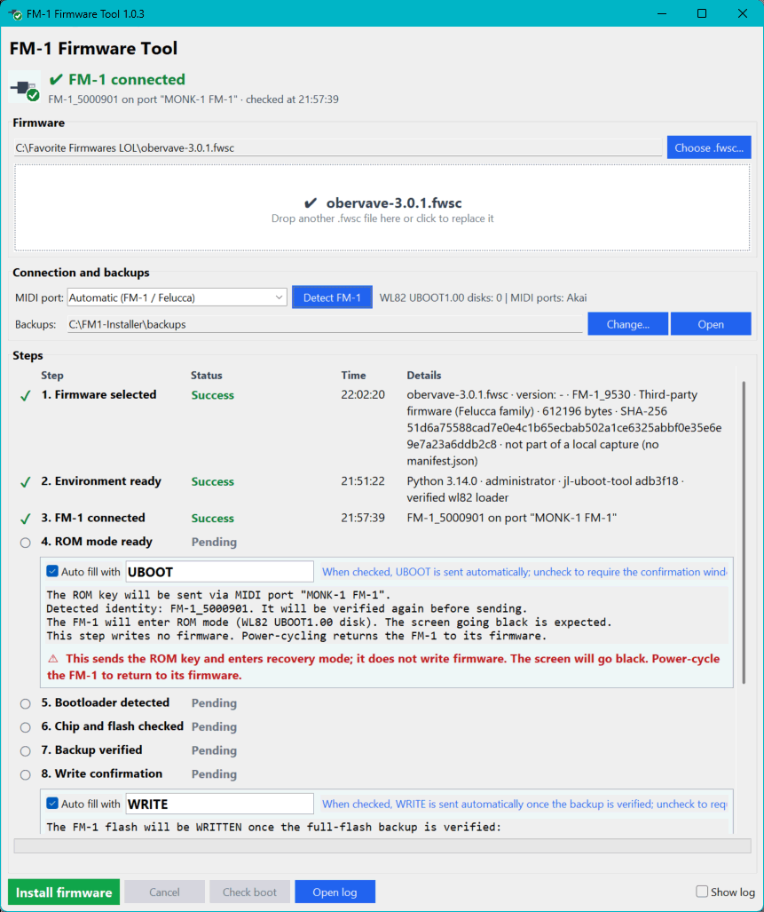

# FM-1 Firmware Tool

Firmware recovery tool for the M-VAVE FM-1 when the device becomes stuck or unresponsive.



## What problem does this app solve?

Sometimes an M-VAVE FM-1 gets stuck in a reboot loop and the web updater (https://thefirmwarehub.com/) cannot complete the firmware update. The unit may restart repeatedly and report the same firmware version, leaving the normal update route unable to recover it. This Windows tool provides a local recovery route using a saved `.fwsc` firmware package. It accesses the FM-1's recovery mode, makes a verified backup, writes the firmware region, and checks that the result matches the package.

### Why can the updater get stuck?

The symptom alone does not identify one definite cause. The update may not have written the new firmware, a write may have been interrupted, or the firmware may have been written but failed to start. In any of those cases, seeing the same version again is not proof that the update completed; it may simply be the version that remains installed. The FM-1 also has a chip-level recovery mode that can be used separately from its normal firmware. Community technical notes describe that recovery path, but diagnosing the cause on a particular unit requires its update history and device behavior.

### How the app recovers the FM-1

1. It checks the local `.fwsc` package, the PC environment, and the recovery engine before accessing the device.
2. If the FM-1 is still running normal firmware, the app sends the `UBOOT` ROM key after checking the device identity. **Auto fill with UBOOT is on by default**; you can switch it off to require a confirmation window. A black screen while it enters recovery mode is expected.
3. It checks that exactly one `WL82 UBOOT1.00` recovery disk is present and verifies the chip and flash identifiers.
4. It reads the full flash twice and compares the reads, then verifies the saved backup. **Auto fill with WRITE is on by default**, so the app sends `WRITE` automatically after the backup is verified. Switch it off to require the exact `WRITE` confirmation window.
5. It writes only the firmware region (`0x4000..0x92FFF`); the boot head (`0x0000..0x3FFF`) is left untouched. It then reads the written region back and compares it byte by byte.
6. After verification, you power-cycle the FM-1 and run **Check boot** to confirm that the firmware starts.

### Advantages and trade-offs

1. **A recovery route when the web update is unavailable:** the app writes from a local firmware package through the chip's recovery mode rather than relying on the running firmware to complete its own update.
2. **A checked way back:** the full-flash backup must pass two matching reads and a file read-back check before the app proceeds with the firmware write.
3. **A limited, verified write:** the boot head is preserved, and the firmware region is read back after writing.
4. **The process still carries risk:** a power loss or disconnection during erase, write, or verification can leave the firmware region incomplete. Keep the FM-1 powered and connected, and follow the app's warnings.
5. **It needs the right inputs and setup:** use a valid local `.fwsc` package, a USB data cable, and administrator privileges for the recovery operation. Automatic `WRITE` confirmation is on by default; switch it off if you want to type `WRITE` manually. The app does not repair hardware faults or extract firmware from `.exe` or `.zip` installers.

The app uses the pinned recovery engine in `motor/`. It is an independent recovery utility and is not an official M-VAVE product. See the [M-VAVE FM-1 product page](https://www.m-vave.com/product?id=fm-1) for the manufacturer's firmware and software, and the community [FM-1 recovery notes](https://github.com/aroum/fm1-custom-fw/blob/main/REVERSE_ENGINEERING.md) for background on the chip-level recovery mode.

## Quick start

You need Windows, Python 3.11 or later, and an FM-1 USB data cable. Keep the FM-1 disconnected while installing the dependencies.

From the project folder, open PowerShell and run:

```powershell
py -3 -m pip install -r motor\requirements-lock.txt
```

Then double-click [`run_gui.bat`](run_gui.bat). Choose your `.fwsc` file, connect the FM-1, click **Detect FM-1**, and follow the prompts.

Do not disconnect or power off the FM-1 while firmware is being written. If the app displays a safety warning, follow it before doing anything else.

The app keeps its existing data folder, `Documents\FM1-Installer`, for backups and logs so previously saved files remain available. Backups contain device data; do not share them publicly.

## Console use

Open Command Prompt or PowerShell in the project folder. For installation, run the console as administrator:

```powershell
.\fm1.bat install "C:\path\to\firmware.fwsc"
.\fm1.bat check "C:\path\to\firmware.fwsc"
.\fm1.bat detect
```

`check` inspects the package and local setup without accessing the FM-1. For more help, run:

```powershell
.\fm1.bat install --help
```

## Development quick start

Run the hardware-free test suite from the project folder:

```powershell
py -m unittest discover -s tests
```

Build the Windows app with:

```powershell
.\build.ps1
```

The build script creates an isolated `.venv`, installs pinned dependencies, checks the recovery-engine files, runs the tests, and creates a versioned app folder and ZIP under `dist\`. Set the version in `app/__init__.py` (`__version__`) before a release. The ZIP contains the full application folder; do not distribute the EXE on its own.

## More information

See [Technical details](TECHNICAL_DETAILS.md) for recovery and safety checks, simulation, troubleshooting, and build details.

## License

This project is licensed under the MIT License. See [LICENSE](LICENSE).

Third-party components retain their own license notices in `motor/`.

## AI-Assisted Development

This project was developed extensively using AI-assisted coding tools, including **ChatGPT, OpenAI Codex, Anthropic Claude, GitHub Copilot, OpenCode, and DeepSeek**, integrated into **Visual Studio Code**.

AI was primarily responsible for generating source code, implementation details, and documentation, under human direction and supervision.
